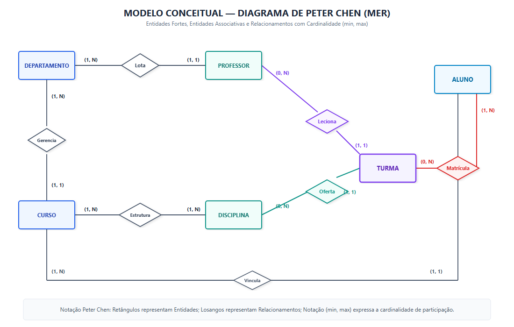
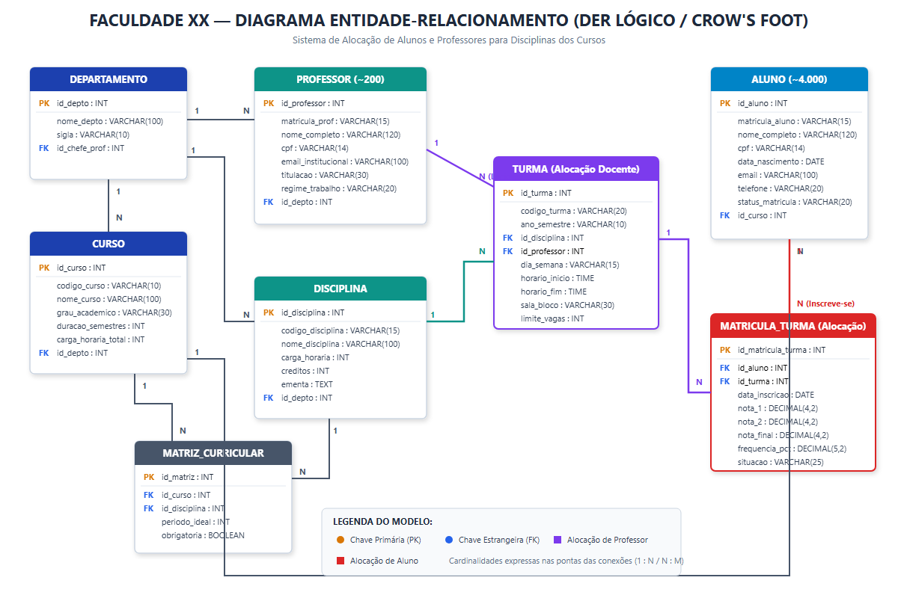

<h1 align="center">🎓 Sistema de Alocação Acadêmica — Faculdade XX</h1>
<h3 align="center">Modelagem Conceitual (MER), Lógica (DER) e Implementação Relacional em SQL</h3>

<p align="center">
  
  
  
  
  
  
</p>

---

## 📌 Visão Geral do Projeto

Este projeto apresenta a solução arquitetural de banco de dados para a **Faculdade XX**, uma instituição de ensino superior fictícia de grande porte responsável pela gestão de **cerca de 200 professores** e **4.000 alunos**, distribuídos em cinco cursos de graduação de áreas distintas:

1. **Sistemas de Informação** (Bacharelado, 8 semestres);
2. **Medicina** (Bacharelado, 12 semestres);
3. **Engenharia Aeroespacial** (Bacharelado, 10 semestres);
4. **Fisioterapia** (Bacharelado, 10 semestres);
5. **Gestão de Recursos Humanos** (Tecnólogo, 4 semestres).

---

## 🎯 O Problema de Negócio & Desafio da Alocação

Com a expansão da instituição, o processo de alocação de disciplinas, professores e alunos tornou-se um gargalo operacional crítico, gerando:
* **Conflitos de Horário Docente:** Professores alocados para aulas no mesmo dia e horário em locais distintos;
* **Superlotação e Ociosidade:** Inexistência de controle automatizado de capacidade física (`limite_vagas`) em salas de aula e laboratórios;
* **Inconsistência nas Matrículas Discentes:** Alunos matriculados em turmas duplicadas ou sem registro formal de pré-requisitos;
* **Dificuldade na Rastreabilidade Acadêmica:** Complexidade na consolidação de notas parciais, médias finais e frequência escolar.

---

## 💡 A Solução Arquitetural

A solução adota o **desacoplamento em 3 camadas semânticas**:
1. **Catálogo Curricular (`DISCIPLINA` + `MATRIZ_CURRICULAR`):** Matérias abstratas pertencentes à grade curricular de cada curso;
2. **Oferta Semestral & Alocação Docente (`TURMA`):** A materialização da disciplina em um semestre específico (ex: `2026.1`), com dia, horários de início/fim, sala física e o professor regente alocado;
3. **Inscrição & Alocação Discente (`MATRICULA_TURMA`):** Associação individualizada do aluno na turma, controlando vagas, notas parciais, média e faltas.

---

## 📐 Diagramas do Modelo de Banco de Dados

### 1. Diagrama Entidade-Relacionamento Conceitual (Notação Peter Chen)
Modela a semântica de negócio com retângulos (entidades), losangos (relacionamentos) e cardinalidades de participação `(min, max)`:

<p align="center">
  
</p>

### 2. Diagrama Entidade-Relacionamento Lógico (Notação Crow's Foot)
Modela o esquema relacional com chaves primárias (`PK`), estrangeiras (`FK`), tipos de dados e regras de integridade:

<p align="center">
  
</p>

---

## 🔬 Comprovação da Normalização Relacional (3FN)

O esquema relacional foi auditado e estruturado rigorosamente até a **3ª Forma Normal (3FN)**:

| Forma Normal | Regra Aplicada | Como foi atendida no Projeto |
| :--- | :--- | :--- |
| **1ª Forma Normal (1FN)** | Valores atômicos e indivisíveis; ausência de grupos repetidores. | Telefones, endereços e identificadores foram atomizados. Disciplinas cursadas foram desacopladas para a tabela associativa `matricula_turma`. |
| **2ª Forma Normal (2FN)** | Estar na 1FN e todos os atributos não-chave dependerem da chave primária inteira. | Ausência de dependências parciais nas tabelas associativas (`matriz_curricular` e `matricula_turma`), garantindo integridade das chaves compostas. |
| **3ª Forma Normal (3FN)** | Estar na 2FN e não possuir dependências transitivas entre atributos não-chave. | Dados cadastrais de curso, departamento e professor são referenciados unicamente por chaves estrangeiras (`FK`), evitando duplicações transitivas. |

---

## 🚀 Como Executar e Testar o Projeto

O projeto conta com uma **suíte de testes automatizados em Python** utilizando o `sqlite3` nativo (não requer instalação de nenhum software externo).

### 1. Clone o repositório:
```bash
git clone https://github.com/SEU-USUARIO/faculdade-xx-banco-de-dados.git
cd faculdade-xx-banco-de-dados
```

### 2. Execute a suíte de testes:
```bash
python scripts/testar_modelo.py
```

### 📋 O que a suíte de testes valida automaticamente:
* [x] Criação de todas as 9 tabelas relacionais com chaves primárias e estrangeiras;
* [x] Carga de dados inicial para os 5 departamentos, 5 cursos, professores, alunos e turmas;
* [x] **Teste de Bloqueio UNIQUE:** Impede que um aluno se matricule duas vezes na mesma turma;
* [x] **Teste de Bloqueio FK:** Impede a alocação de um professor ou disciplina inexistente;
* [x] **Teste de Bloqueio CHECK:** Impede lançamentos de notas inválidas (fora do intervalo 0 a 10) ou horários inconsistentes;
* [x] Geração dos relatórios de alocação docente e espelho de matrícula discente.

---

## 📊 Consultas SQL de Negócio (Relatórios)

### Relatório de Alocação de Docente (Grade Horária dos Professores)
```sql
SELECT 
    p.nome_completo AS professor,
    p.titulacao,
    c.nome_curso,
    d.nome_disciplina,
    t.codigo_turma,
    t.dia_semana,
    t.horario_inicio || ' às ' || t.horario_fim AS horario,
    t.sala_bloco,
    t.limite_vagas
FROM turma t
INNER JOIN professor p ON t.id_professor = p.id_professor
INNER JOIN disciplina d ON t.id_disciplina = d.id_disciplina
INNER JOIN matriz_curricular mc ON d.id_disciplina = mc.id_disciplina
INNER JOIN curso c ON mc.id_curso = c.id_curso
ORDER BY t.dia_semana, t.horario_inicio;
```

### Comprovante de Matrícula do Aluno (Alocação Discente)
```sql
SELECT 
    a.matricula_aluno,
    a.nome_completo AS aluno,
    c.nome_curso,
    d.nome_disciplina,
    p.nome_completo AS professor_responsavel,
    t.dia_semana || ' (' || t.horario_inicio || ')' AS dia_horario,
    t.sala_bloco,
    mt.situacao
FROM matricula_turma mt
INNER JOIN aluno a ON mt.id_aluno = a.id_aluno
INNER JOIN curso c ON a.id_curso = c.id_curso
INNER JOIN turma t ON mt.id_turma = t.id_turma
INNER JOIN disciplina d ON t.id_disciplina = d.id_disciplina
INNER JOIN professor p ON t.id_professor = p.id_professor
ORDER BY a.nome_completo;
```

---

## 📁 Estrutura do Repositório

```text
faculdade-xx-banco-de-dados/
├── README.md                 # Apresentação completa do projeto
├── LICENSE                   # Licença MIT
├── .gitignore                # Arquivos ignorados pelo Git
├── docs/                     # Documentação acadêmica e diagramas
│   ├── Trabalho_ADS_Modelo_Conceitual_MER_DER.pdf
│   ├── Trabalho_Faculdade_XX_MER_DER.docx
│   ├── der_chen.png          # Diagrama Peter Chen (PNG alta resolução)
│   ├── der_chen.svg          # Diagrama Peter Chen (Vetor SVG)
│   ├── der_logical.png       # DER Crow's Foot (PNG alta resolução)
│   └── der_logical.svg       # DER Crow's Foot (Vetor SVG)
├── sql/                      # Scripts SQL modulares
│   ├── 01_schema.sql         # Criação de tabelas, PKs, FKs e constraints
│   ├── 02_seed_data.sql      # Carga realista dos 5 cursos e alocações
│   ├── 03_queries.sql        # Consultas de negócio e relatórios
│   └── faculdade_xx_full.sql # Script completo em arquivo único
└── scripts/                  # Scripts de execução e testes
    ├── testar_modelo.py      # Runner de testes automatizados com SQLite
    └── faculdade_xx.db       # Banco de dados SQLite populado
```

---

## 🛠️ Tecnologias e Ferramentas

* **Modelagem:** Notação Peter Chen (1976) e Notação Crow's Foot (Engenharia de Informação)
* **Linguagens de Banco de Dados:** SQL ANSI, compatível com PostgreSQL, MySQL e SQLite
* **Validação e Testes:** Python 3.x (`sqlite3` standard library)
* **Padronização:** ABNT (Associação Brasileira de Normas Técnicas)

---

## 📄 Licença

Este projeto está sob a licença [MIT](LICENSE).

---

<p align="center">
  Desenvolvido por <strong>Lucas Bezerra</strong><br>
  Estudante de Análise e Desenvolvimento de Sistemas (ADS)<br>
  Rio de Janeiro — RJ | 2026
</p>
